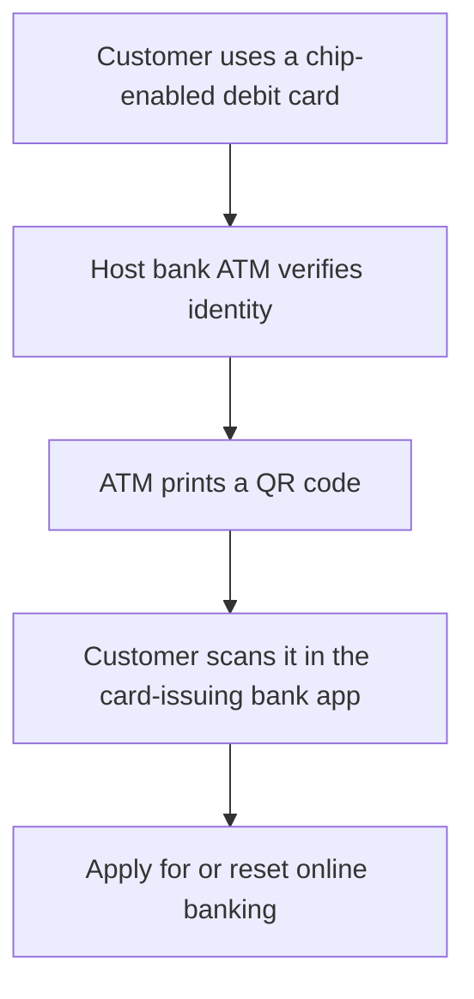

# Fintech Product Cases

Product decisions from digital banking, starting with cross-bank identity verification for online-banking onboarding.

## Cross-bank identity verification for online banking

[Read the case study →](case-study.md)

### My role and scope

At a Taiwanese bank, I led the platform from design through regulatory pre-review submission, aligned compliance, risk, IT and banking partners, and wrote the business case.

### Business-case projections

The business case projected a **25% reduction in processing time** and new fee revenue equal to **15% of ATM revenue**.

Approval and public launch followed my departure; the projected figures are not measured results from my tenure.

### The later public customer journey

This simplified journey reflects a later public announcement, with the bank and its partners anonymized.

### A second product decision

The case also examines a user-research funding decision: reframing the discussion around expected costs and benefits and proposing an existing, approved open-banking budget.
